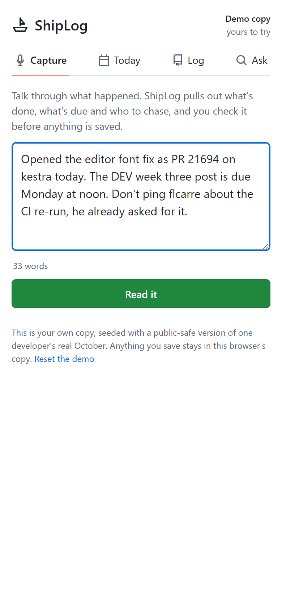
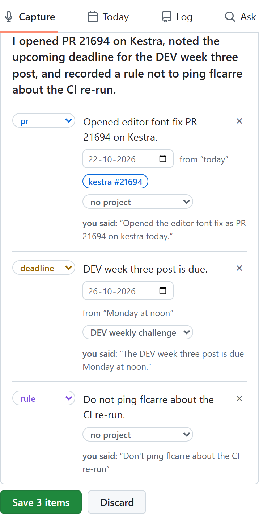
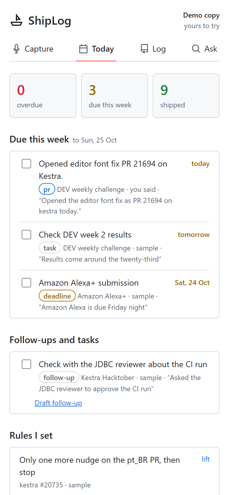
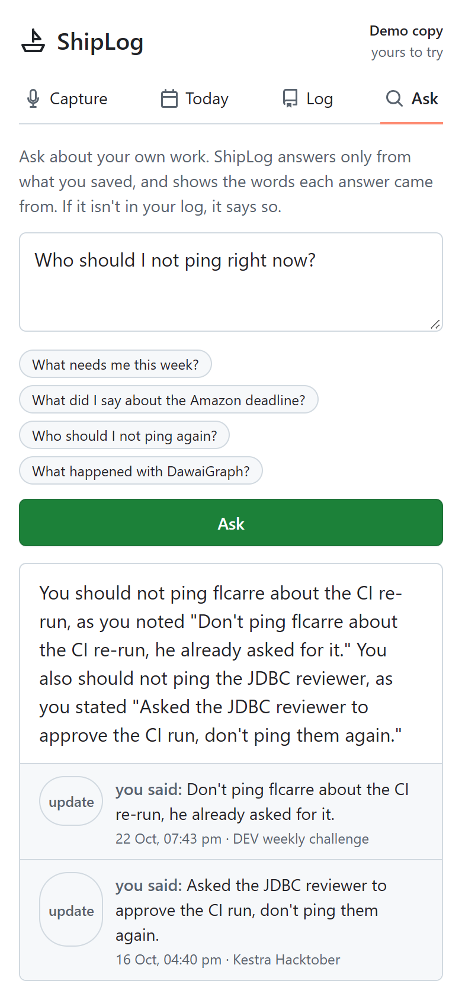

# ShipLog

**Talk through your work. ShipLog keeps the log, the deadlines and the follow-ups.**

**Live:** https://shiplog-1037019152152.asia-south1.run.app (no sign-up: every browser gets its own copy of the demo)

**Demo video (2 min):** https://youtu.be/fVCo67z4U1s

Built for *No Hands: The Wispr Challenge* (WeMakeDevs × Wispr Flow), Builders track, 16-30 Oct 2026. Every prompt, spec note and review comment for this project was dictated through Wispr Flow.

I juggle ten hackathons, open pull requests and reviewers I must not ping twice, all in one long markdown tracker I update by hand. ShipLog lets me say the update instead: it pulls out what's done, what's due, who to chase and the rules I set, shows me exactly which of my words each item came from, and saves only what I confirm.

| Capture | Review | Today | Ask |
|---|---|---|---|
|  |  |  |  |

## What it does

1. **Capture.** Hold the Wispr Flow key and talk into the box. "Read it" sends the update to Gemini.
2. **Review.** Every item it found (done, task, deadline, follow-up, rule, PR) is shown with the exact words it came from. Edit, retag or remove anything, then save. Items whose words can't be found in the update are left out and listed as "couldn't trace".
3. **Today.** Overdue and due-this-week (IST), open follow-ups, the rules you set, and the PRs you mentioned with their **live GitHub state** (open, merged, review decision, CI), each marked "GitHub, checked hh:mm". Deadlines download as a real `.ics` calendar file.
4. **Log.** Every update with its summary, its items and, on tap, what you actually said. Search and filter by project.
5. **Ask.** "Who should I not ping again?" is answered only from what you saved, with the quote and date behind it. If it isn't in your log, it says "That isn't in your log yet, so I won't guess."
6. **Follow-up drafts** that obey your rules: ask for a nudge to a reviewer you said not to ping and ShipLog refuses, quoting your rule.
7. **Reads updates like speech.** Self-corrections ("Tuesday, no wait, Wednesday"), take-backs ("scratch that"), hedges ("I think" = unsure), urgency ("really urgent" = priority) and spoken numbers ("PR two one eight six seven" = #21867). It reads by itself when Flow finishes typing.
8. **Talk to edit.** "The Kestra one is done", "push the video to Thursday": ShipLog shows the change and applies it only when you confirm.
9. **Needs you.** Merges close their items; failing checks, requested changes and new comments surface. GitHub (Connect GitHub, read-only OAuth) and GitLab merge requests. Deadlines as a calendar subscription.
10. **Flow tab.** Names Flow misheard and the words to add to Flow's Dictionary, plus ready Snippets for your repos.
11. **Write.** Stand-up, weekly report and a post from your log, each citing the items it used. Never sent for you.
12. **Telegram.** Talk to the ShipLog bot with the Flow phone keyboard, see what was understood, tap Save or Discard.

## Trust rules (these are the product)

- **The model proposes, code decides.** Gemini suggests items; code checks every quote is really in your update, every PR number and date is in your words, and resolves dates ("Friday night", "next Wednesday", "Monday at noon") against the capture time in IST.
- **Every fact is labelled:** *you said* (your capture), *GitHub* (fetched, with the time), *sample* (demo seed).
- **Nothing is sent or posted.** Follow-ups are drafts you copy; GitHub access is read-only.
- Text in your updates and on GitHub is data, never instructions.

## How Wispr Flow is used

ShipLog has no microphone code: Wispr Flow types into the capture and Ask boxes like into any other app, on a phone or a laptop. That is the point. The messy, run-on way people talk about their work ("pushed the fixes on 1063, oh and GitLab is due the twenty-seventh, don't ping him again") is exactly what a tracker needs, and Flow turns it into clean text with lists, numbers and PR ids intact. I built ShipLog the same way: specs, prompts, reviews and the daily #NoHandsChallenge posts were all dictated.

## Design

The interface follows **Primer**, GitHub's open-source design system (colour tokens, type scale, underline tabs, labels, PR state colours and Octicons), in light and dark. ShipLog lives next to your pull requests, so it should feel at home there.

## Run it

```bash
python -m venv .venv && .venv/Scripts/pip install -r requirements.txt   # Windows; use .venv/bin on macOS/Linux
set GEMINI_API_KEY=...            # never commit it
.venv/Scripts/python -m uvicorn server:app --app-dir app --port 8791
.venv/Scripts/pip install playwright pytest && .venv/Scripts/python -m pytest tests
```

- **Stack:** FastAPI + one static page (vanilla JS), Gemini (`gemini-3.5-flash`) over REST with a JSON schema, GitHub REST (read-only, cached 5 min).
- **Storage:** one JSON document per workspace; local files in development, a Cloud Storage bucket in production (`SHIPLOG_BUCKET`).
- **Workspaces, no sign-up:** each browser gets a random workspace key and its own copy of the demo; "Reset the demo" restores it. The owner's real workspace uses a private key (`SHIPLOG_OWNER_KEY`).
- **Deploy:** `gcloud run deploy shiplog --source . --region asia-south1 --max-instances 1` (see `Dockerfile`).
- **Tests:** 73 (`pytest tests`: date resolution, quote tracing, invented dates and PR numbers flagged, rule-blocked drafts, GitHub outages shown as unknown, Ask citations, parallel workspace creation, speech reading, talk to edit, needs you, Flow words, reports, owner workspace) including a phone-viewport end-to-end run of capture → review → save → Today → Log against the real server.

Design notes: [docs/spec.md](docs/spec.md). Build log: one commit per day, each dictated.

## License

MIT
